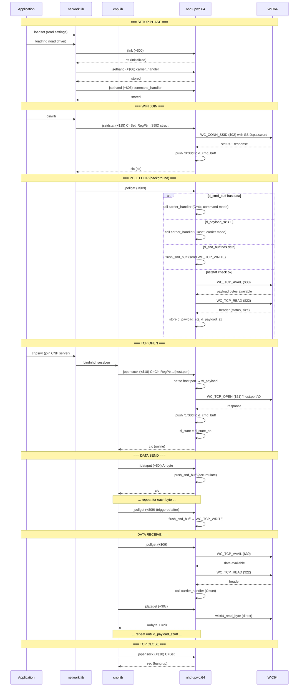
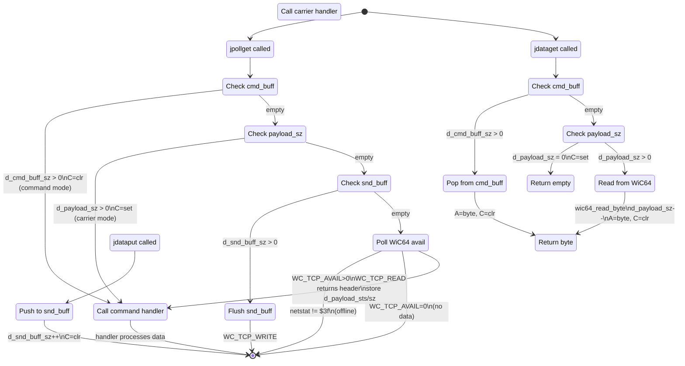
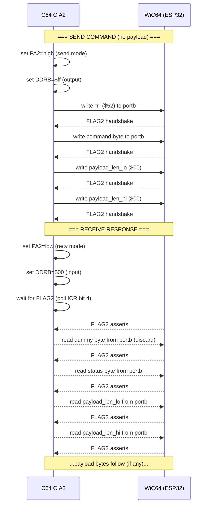

# C64 OS Network Driver Technical Reference

## C64 OS Networking Stack

C64 OS networking is a layered architecture that separates application code from hardware:

```
Application (e.g., web browser, chat client)
    |
    v
network.lib    -- High-level network API, settings management
    |
    v
cnp.lib        -- Commodore Network Protocol (session, auth, packet mgmt)
    |
    v
nhd.* driver   -- Network Hardware Driver (this project: nhd.upwc.64)
    |
    v
Physical HW    -- WiC64 cartridge (ESP32-based, WiFi TCP/IP)
```

**Call chain:** Application calls `network.lib` (e.g., `loadset`, `joinwifi`, `cnpsrvr`), which calls `cnp.lib`, which calls the NHD driver's jump table. The application never calls the NHD driver directly.

---

## NHD Driver Contract

Every NHD driver is a relocatable PRG loaded into low memory. It exposes an 11-entry jump table at its load address. C64 OS calls these entries by offset (`link_ = $00`, `unlink_ = $03`, etc.).

From the C64 OS v1.08 reference (`os/h/nhd.t`):

```text
link_     = $00  ; Initialize driver, allocate buffers, wedge NMI
unlink_   = $03  ; Deallocate buffers, restore NMI
sethand_  = $06  ; Set carrier/command mode handlers
pollget_  = $09  ; Poll incoming buffer for data
dataget_  = $0c  ; Fetch a byte from Rx buffer
dataput_  = $0f  ; Put a byte in Tx buffer
setrate_  = $12  ; Set baud rate (auxiliary)
ssidstat_ = $15  ; Read or Join SSID (auxiliary)
opensock_ = $18  ; Open or close TCP socket (auxiliary)
nhdpause_ = $1b  ; Pause NMI/IRQ handling
nhdresum_ = $1e  ; Resume NMI/IRQ handling
```

### Key conventions

| Entry | Carry In | RegPtr In | Carry Out | Meaning |
|---|---|---|---|---|
| `sethand` | Clr=Command | Handler addr | Set | Handler stored |
| `sethand` | Set=Carrier | Handler addr | Set | Handler stored |
| `pollget` | — | — | Clr/Hndlr | Calls handler (C=mode) |
| `dataget` | — | — | Clr=Got byte | A←byte |
| `dataget` | — | — | Set=Empty | No data |
| `dataput` | — | A→byte | Clr | Buffered |
| `ssidstat` | Clr=Read | — | Set=No SSID | Read current SSID |
| `ssidstat` | Set=Join | Wifi struct | — | Initiate join |
| `opensock` | Clr=Open | Socket struct | Clr=Online | TCP open |
| `opensock` | Set=Close | — | — | TCP close |

### Network status byte (`netstat` at `$0245`)

From `os/s/network.t`:

```
Bit 0 (ns_nhcf) = NHD configured   (driver loaded, hardware found)
Bit 1 (ns_nhsp) = NHD speed set    (baud rate initialized)
Bit 2 (ns_trcf) = Transport conf'd (WiFi SSID/password set)
Bit 3 (ns_trup) = Transport up     (WiFi joined and connected)
Bit 4 (ns_cpcf) = CNP configured   (CNP server address set)
Bit 5 (ns_cpup) = CNP connected    (CNP session established)

ns_onlin = $3f  (all bits set = fully online)
```

### SSID join struct offsets (`os/s/nhd.s`)

```text
wifi_ssid = $00  ; 2-byte pointer to SSID string
wifi_pass = $02  ; 2-byte pointer to password string
```

### TCP socket struct offsets (`os/s/nhd.s`)

```text
tcp_host = $00   ; 2-byte pointer to hostname string
tcp_port = $02   ; 2-byte pointer to port string
```

---

## WiC64 Hardware Protocol

The WiC64 is an ESP32-based cartridge that connects to the C64 User Port. It uses a ZiModem-like parallel protocol via CIA2.

### CIA2 Register Map

| Register | Address | Purpose |
|---|---|---|
| `ddra` | `$dd02` | PA direction (bit 2 = PA2) |
| `ddrb` | `$dd03` | PB direction (all 8 bits) |
| `porta` | `$dd00` | PA data (bit 2 = direction control) |
| `portb` | `$dd01` | PB data (8-bit parallel) |
| `icr` | `$dd0d` | Interrupt control (bit 4 = FLAG2) |

### Direction Control (PA2)

- **PA2 high** = Send mode (C64 → WiC64). DDRB = output (`$ff`).
- **PA2 low** = Receive mode (WiC64 → C64). DDRB = input (`$00`).

### Handshake (FLAG2 / `$dd0d` bit 4)

- WiC64 asserts FLAG2 (bit 4 set in ICR) when data is ready to read / has been read.
- `wic64_read_byte` spins on `icr & $10` until FLAG2 asserts, then reads `portb`.
- `wic64_write_byte` writes `portb`, then spins on `icr & $10` until FLAG2 asserts (handshake complete).

### Command Frame (C64 → WiC64)

```
Byte 0: "r"           (protocol identifier, ASCII 0x52)
Byte 1: command       (e.g., $21 = TCP_OPEN)
Byte 2: payload_len_lo
Byte 3: payload_len_hi
Byte 4..N: payload    (zero-terminated when using string payloads)
```

### Response Frame (WiC64 → C64)

```
Byte 0: dummy         (discard)
Byte 1: status        (0 = success)
Byte 2: payload_len_lo
Byte 3: payload_len_hi
Byte 4..N: payload    (response data)
```

---

## Driver3 Architecture (`nhd.upwc.64`)

### Source File Map

```
build.asm      -- Entry point, *= $d100, debug=1, includes
wic64.h        -- WC_* command constants, CIA2 regs, macros (w_snd_cmd, w_rcv_dat)
inc.asm        -- C64 OS #inc_s includes (app, network, nhd, pointer, memory, screen, service)
main.asm       -- Jump table, buffer ops (push/pop cmd/rcv/snd), flush_snd_buff, delay, handlers
vars.asm       -- Zero-page vars (sptr=$61, ptr=$63)
data.asm       -- d_state, d_snd_buff[64], d_rcv_buff[64], d_cmd_buff[16], d_payload_sz, w_payload[64]
jlink.asm      -- Initialize externals, set state to d_state_none
junlink.asm    -- Stub (RTS)
jsethand.asm   -- Store carrier/command handler vectors into mode_carrier+1 / mode_command+1
jpollget.asm   -- Poll cmd_buff → wic_buff → snd_buff → WiC64 avail/read
jssidstat.asm  -- Join or read SSID (join not yet implemented; fakes ack bytes)
jdataget.asm   -- Pop from cmd_buff, or read directly from WiC64 via wic64_read_byte
jdataput.asm   -- Push byte to d_snd_buff
jsetrate.asm   -- Stub (always clc)
jopensock.asm  -- Parse host:port from CNP struct → send WC_TCP_OPEN
wic64.asm      -- Low-level: send/recv mode, read/write byte, send cmd, recv header/data
sys.asm        -- External syscalls (pgalloc, pgfree, pet2asc, quitapp)
```

### Buffers

| Label | Size | Purpose |
|---|---|---|
| `d_state` | 16 | State machine (offline, online, wifi, opened, closed) |
| `d_snd_buff` | 64 | Outgoing data buffer (accumulated by `jdataput`, flushed by `jpollget`) |
| `d_rcv_buff` | 64 | Receive buffer (currently unused) |
| `d_cmd_buff` | 16 | Command ack/status buffer for CNP responses ("0"$0d, "1"$0d) |
| `d_payload_sz` | 2 | Pending WiC64 payload size (set by `jpollget`, consumed by `jdataget`) |
| `d_payload_sts` | 1 | Pending WiC64 payload status |
| `d_snd_buff_pos` | 16 | Send buffer write position |
| `d_snd_buff_sz` | 16 | Send buffer fill count |
| `d_cmd_buff_pos` | 16 | Command buffer read position |
| `d_cmd_buff_sz` | 16 | Command buffer fill count |
| `w_payload` | 64 | Working buffer (host:port string construction) |

---

## Call Flow Diagrams

### Application → Driver Call Flow



### Buffer State Machine (jpollget + jdataget + jdataput)



### WiC64 Hardware Protocol



---

## WiC64 Command Reference

### Currently Used Commands

| Command | Value | Used In | Purpose |
|---|---|---|---|
| `WC_GET_VER_STR` | `$00` | *(planned)* | Detect WiC64 hardware |
| `WC_CONN_SSID` | `$02` | *(planned)* | Join WiFi network |
| `WC_GET_SSID` | `$10` | *(planned)* | Read current SSID |
| `WC_TCP_OPEN` | `$21` | `jopensock.asm` | Open TCP connection |
| `WC_TCP_READ` | `$22` | `jpollget.asm` | Request incoming data |
| `WC_TCP_WRITE` | `$23` | `flush_snd_buff` | Send outgoing data |
| `WC_TCP_CLOSE` | `$2e` | *(planned)* | Close TCP connection |
| `WC_IS_CONNECT` | `$2c` | *(planned)* | Check WiFi connection status |
| `WC_IS_CONFIG` | `$2f` | *(planned)* | Check if WiC64 is configured |
| `WC_TCP_AVAIL` | `$30` | `jpollget.asm` | Query available bytes |
| `WC_ECHO` | `$fe` | *(planned)* | Ping/detect WiC64 |

---

## State Machine (`d_state`)

```
d_state_off  = $fe  -- offline/uninitialized
d_state_none = $ff  -- not configured
d_state_on   = $00  -- online (socket open)
d_state_wifi = $30  -- wifi joined (not yet connected)
d_state_opn  = $10  -- socket opened
d_state_cls  = $20  -- socket closed
```

Current implementation uses `d_state` sparingly — set in `jlink` and `jopensock`, read in `jpollget`. The state machine is not yet fully integrated into all paths.

---

## Known Technical Limitations

1. **No hardware detection** — `jlink` should verify WiC64 is present via `WC_ECHO` or `WC_GET_VER_STR`
2. **WiFi join not implemented** — `jssidstat` returns fake ack bytes without actually sending `WC_CONN_SSID`
3. **Fragile online check** — `jpollget` uses `$0245 (netstat) == $3f` as proxy for being online; should use `WC_IS_CONNECT`
4. **Per-byte TCP writes** — `flush_snd_buff` sends one `WC_TCP_WRITE` per byte; should buffer to fill MTU
5. **Unused rcv_buff** — `d_rcv_buff` allocated but not used; current path reads directly from WiC64
6. **Fixed buffer sizes** — All buffers use `.repeat` directives; should use `pgalloc` for page-aligned memory
7. **No IRQ support** — Driver is purely poll-based; `nhdpause`/`nhdresum` are stubs
8. **Deprecated z* files** — `zmain.asm`, `zwic64.asm`, `zwic64.h`, `zwic64.mac` are redundant with the `j*.asm` + `wic64.asm` path

## Official WiC64 Library Protocol Reference (v2.0.0+)

Source: [WiC64-Team/wic64-library](https://github.com/WiC64-Team/wic64-library) — the canonical reference implementation.

### Protocol Overview

The WiC64 uses a byte-oriented parallel handshake protocol over the C64 User Port (CIA2). Every byte transfer is acknowledged via FLAG2 handshake (`$dd0d` bit 4). The library is written in **acme cross assembler** (not Turbo Macro Pro), uses `!zone` for scoping, `!source` for includes, and `!pseudopc` for position-independent code.

### Protocol Byte Format (Standard vs Extended)

There are two protocol variants selected by the first byte:

| Protocol | First Byte | Header Size | Payload Size Encoding |
|----------|-----------|-------------|-----------------------|
| Standard | `"R"` ($52) | 4 bytes | 2-byte little-endian at offset 2-3 (max 65535 bytes payload) |
| Extended | `"E"` ($45) | 6 bytes | 4-byte little-endian at offset 2-5 (useful for >64KB payloads) |

**Standard command frame (C64 → WiC64):**

```
Byte 0: "R"              ($52, protocol identifier)
Byte 1: command          (e.g., $21 = TCP_OPEN)
Byte 2: payload_len_lo   (low byte of 16-bit length)
Byte 3: payload_len_hi   (high byte of 16-bit length)
Byte 4..N: payload       (exactly payload_len bytes, no NUL termination required)
```

**Extended command frame (C64 → WiC64):**

```
Byte 0: "E"              ($45, extended protocol identifier)
Byte 1: command          (same command set)
Byte 2: payload_len_ll   (byte 0 of 32-bit length)
Byte 3: payload_len_lh   (byte 1)
Byte 4: payload_len_hl   (byte 2)
Byte 5: payload_len_hh   (byte 3)
Byte 6..N: payload
```

**Response frame (WiC64 → C64) — NO dummy byte:**

```
Byte 0: status           (0 = success, 1-5 = error)
Byte 1: payload_len_lo
Byte 2: payload_len_hi
Byte 3..N: payload       (exactly payload_len bytes)
```

**CRITICAL: The official library has NO dummy byte before status.** This differs from older documentation. Our `src1/wic64.asm` currently reads a dummy byte, which shifts everything by one byte and causes protocol desync.

### Status Codes

| Symbol | Code | Meaning |
|--------|------|---------|
| `WIC64_SUCCESS` | 0 | No errors |
| `WIC64_INTERNAL_ERROR` | 1 | Firmware bug / unexpected condition |
| `WIC64_CLIENT_ERROR` | 2 | Malformed request from C64 |
| `WIC64_CONNECTION_ERROR` | 3 | No WiFi connection |
| `WIC64_NETWORK_ERROR` | 4 | Transport-level failure |
| `WIC64_SERVER_ERROR` | 5 | Remote server error |

After receiving a non-zero status, the C64 can request a human-readable error message via `WIC64_GET_STATUS_MESSAGE` ($2a), passing a payload byte: 0=lowercase, nonzero=uppercase PETSCII.

### Handshake Protocol (Critical Detail)

**Switching to send mode (C64 → WiC64):**

```
1. Set PA2 high:    lda $dd00 : ora #$04 : sta $dd00    (direction = C64 output)
2. Set DDRB to out: lda #$ff : sta $dd03                (port B = all outputs)
3. For each byte written to $dd01, wait for FLAG2 handshake.
```

**Switching to receive mode (WiC64 → C64):**

```
1. Set DDRB to in:  lda #$00 : sta $dd03                (port B = all inputs)
2. Pull PA2 low:    lda $dd00 : and #!$04 : sta $dd00   (direction = C64 input)
3. Wait for FLAG2 handshake  ← THE WIC64 ACKNOWLEDGES THE DIRECTION CHANGE
4. Read $dd01                  ← THIS ACKNOWLEDGES THE WIC64 (asserts PC2 line)
5. For each subsequent byte: wait for FLAG2 → read $dd01
```

**BUG IN OUR CODE:** `wic64_do_recv_mode` in `src1/wic64.asm` does steps 1-2 but **omits steps 3-4**. This causes a protocol desync: the first `wic64_read_byte` after `wic64_do_recv_mode` gets the direction-change handshake instead of actual data, effectively "eating" the first response byte.

### Send Implementation

```
1. wic64_initialize:
   - Read $dd0d (clear FLAG2 bit)
   - Set PA2 direction bit in $dd02 to output
   - Disable IRQs (sei) unless wic64_dont_disable_irqs is set
   - clc

2. wic64_send_header:
   - Set PA2 high, DDRB = $ff (send mode)
   - Copy bytes 0-5 of request header (6 bytes buffer, but only 4 are header for standard, 6 for extended)
   - Detect protocol: if first byte is "E", set wic64_request_header_size=6, wic64_response_header_size=5
   - Send header bytes with handshake after each
   - Advance request pointer past header bytes

3. wic64_send:
   - Send remaining payload bytes with handshake after each
   - Tracks bytes sent via wic64_bytes_to_transfer and wic64_transfer_size
   - Supports page-based transfer for efficiency (>256 bytes)
```

### Receive Implementation

```
1. wic64_receive_header:
   - Set DDRB = $00, pull PA2 low (recv mode)
   - Wait for FLAG2 handshake (WiC64 confirms direction)
   - Read $dd01 (dummy acknowledge)
   - Read 3 bytes (standard) or 5 bytes (extended) response header:
     status, size_lo, size_hi [, size_extra_lo, size_extra_hi]
   - Store status to wic64_status
   - Store size to wic64_response_size and wic64_bytes_to_transfer
   - If status != 0, call finalize then jump to error handler (if installed)

2. wic64_receive:
   - Wait for FLAG2 → read $dd01 for each payload byte
   - Uses self-modifying sta $xxxx,y for destination
   - Page-based transfer

3. wic64_finalize:
   - Set DDRB = $00 (input, idle state)
   - Read $dd0d (clear FLAG2)
   - Restore user timeout
   - Restore IRQ flag state
   - Reset store instruction and auto-discard setting
   - A = wic64_status, rts
```

### Timeout System

- `wic64_timeout` byte: default $02 (~2 seconds). Minimum $01 (~1 second).
- Uses 3 cascaded counters (outer, middle, inner) for the delay loop.
- Inner loop is tuned: if timeout = $01, inner counter = $48 (72), else inner = $00 (256).
- On timeout: calls `wic64_finalize`, sets carry, checks for user-installed timeout handler.
- Timeout handler saves stack pointer, allows resetting stack to a known level on timeout.

### Timeout and Error Handlers

- `wic64_set_timeout_handler` / `wic64_unset_timeout_handler`
- `wic64_set_error_handler` / `wic64_unset_error_handler`
- Handlers are called via `jmp (handler)`, stack pointer reset to saved level.
- `wic64_handlers_suspended` byte: if 0, handlers are skipped and user must test flags manually.

### Custom Fetch/Store Instructions

The library allows replacing the default `lda $xxxx,y` (fetch) or `sta $xxxx,y` (store) instruction with a 3-byte `jsr` to a user routine. This enables:
- On-the-fly data transformation during send/receive
- Streaming data to/from devices without intermediate buffers
- Computing checksums during transfer

### Transfer Speed

- ~42KB/s under optimal conditions (IRQs disabled, screen off)
- ~36KB/s with screen on and moderate IRQ usage
- ~30% slower when optimized for size (adds jsr/rts per byte)
- **No zero-page locations used** by the library
- Critical sections should not cross page boundaries (~2KB/s penalty)

### Full Command Set

| Command | Value | Payload | Response |
|---------|-------|---------|----------|
| `WIC64_GET_VERSION_STRING` | $00 | none | ASCII version string `"2.0.0\0"` |
| `WIC64_GET_VERSION_NUMBERS` | $26 | none | 4 bytes: major, minor, patch, dev |
| `WIC64_SCAN_WIFI_NETWORKS` | $0c | none | List of WiFi networks |
| `WIC64_CONNECT_WITH_SSID_STRING` | $02 | SSID + password with flag byte | status |
| `WIC64_CONNECT_WITH_SSID_INDEX` | $0d | SSID index + password | status |
| `WIC64_IS_CONFIGURED` | $2f | none | 0/1 |
| `WIC64_IS_CONNECTED` | $2c | none | 0/1 |
| `WIC64_GET_MAC` | $14 | none | MAC address string |
| `WIC64_GET_SSID` | $10 | none | Current SSID string |
| `WIC64_GET_RSSI` | $11 | none | Signal strength |
| `WIC64_GET_IP` | $06 | none | IP address string |
| `WIC64_HTTP_GET` | $01 | URL string | HTTP response body |
| `WIC64_HTTP_GET_ENCODED` | $0f | URL with `<$` binary markers | HTTP response body |
| `WIC64_HTTP_POST_URL` | $28 | URL | none (sets target) |
| `WIC64_HTTP_POST_DATA` | $2b | data bytes | HTTP response body |
| `WIC64_TCP_OPEN` | $21 | `"host:port\0"` | status |
| `WIC64_TCP_AVAILABLE` | $30 | none | 2 bytes: available count |
| `WIC64_TCP_READ` | $22 | none, or 2-byte count | raw data bytes |
| `WIC64_TCP_WRITE` | $23 | data bytes | status |
| `WIC64_TCP_CLOSE` | $2e | 0 or 1 (quiet=1) | status |
| `WIC64_GET_SERVER` | $12 | none | Server string |
| `WIC64_SET_SERVER` | $08 | server string | status |
| `WIC64_GET_TIMEZONE` | $17 | none | Timezone string |
| `WIC64_SET_TIMEZONE` | $16 | timezone string | status |
| `WIC64_GET_LOCAL_TIME` | $15 | none | Time string |
| `WIC64_UPDATE_FIRMWARE` | $27 | firmware binary | status |
| `WIC64_REBOOT` | $29 | delay in ms * 10 | (reboots) |
| `WIC64_GET_STATUS_MESSAGE` | $2a | case byte (0=lower, !=0=upper) | error message (max 40 bytes) |
| `WIC64_SET_TRANSFER_TIMEOUT` | $2d | timeout in seconds | status |
| `WIC64_SET_REMOTE_TIMEOUT` | $32 | timeout in seconds | status |
| `WIC64_IS_HARDWARE` | $31 | none | hardware type byte |
| `WIC64_FORCE_TIMEOUT` | $fc | none | (testing) |
| `WIC64_FORCE_ERROR` | $fd | none | (testing) |
| `WIC64_ECHO` | $fe | data bytes | echoed data bytes |

### Hardware Detection (`wic64_detect`)

The official detect routine does:
1. Send `WIC64_GET_VERSION_STRING` using standard protocol
2. If send_header times out → no device present (carry set)
3. Set `wic64_response_size` to `$55` (distinct marker)
4. Receive header — if `wic64_response_size` still `$55` → legacy firmware (zero clear)
5. If new firmware → manually discard response payload bytes (max 30)
6. Set status=0 for new firmware, status=1 for legacy
7. Call finalize, return carry=clear (device present) + zero flag (set=new firmware, clear=legacy)

### Auto-Discard Mode

When `wic64_execute` is called without a `<response>` argument and no custom store instruction is installed, the response payload is automatically discarded by setting the store instruction to three `nop` bytes (`$ea $ea $ea`). This avoids having to allocate memory for a response that the caller doesn't need.

### Key Differences from Our `src1/` Implementation

| Aspect | Official Library | Our `src1/wic64.asm` |
|--------|-----------------|---------------------|
| Assembler | acme (`!source`, `!zone`) | Turbo Macro Pro (`.include`, `.block`) |
| Header size | 4 bytes standard / 6 extended | Always sends 4 bytes |
| Payload counting | Explicit 2-byte size in header | Counts bytes until NUL terminator |
| Response header | status + size_lo + size_hi (3 bytes, no dummy) | dummy + status + size_lo + size_hi (4 bytes with dummy) |
| Recv mode switch | Waits for FLAG2 + reads $dd01 as acknowledge | Just sets registers, no handshake |
| Timeout handling | 3-level cascading counter, configurable | None (infinite loop on FLAG2) |
| IRQ management | Saves/restores interrupt flag, disables during xfer | None |
| Self-modifying code | For source/dest pointers in loops | None |
| Zero page used | None | sptr=$61, ptr=$63, $fa/$fb for indirect |
| Error handling | Status codes 0-5 in response header | No status parsing |
| Speed optimization | ~42KB/s with screen off | Slower (non-page-aligned loops) |

### Important Commands for TCP

**`WIC64_TCP_AVAILABLE` ($30):** Returns 2 bytes (little-endian) indicating how many bytes are available to read from the TCP socket. No additional receive needed — the 2 bytes ARE the payload.

**`WIC64_TCP_READ` ($22):** The official library sends this with NO payload (just the 4-byte header) to read all available bytes, or with a 2-byte payload to specify the max count. The WiC64 sends back raw data bytes in the response payload.

**`WIC64_TCP_OPEN` ($21):** Payload is `"hostname:port\0"` — a NUL-terminated string. The port is a string too (e.g., `"80"` not byte `$50`).

**`WIC64_TCP_CLOSE` ($2e):** Payload of 0 = normal close, 1 = quiet close (no RST sent).

**`WIC64_CONNECT_WITH_SSID_STRING` ($02):** Payload format: `SSID\0password` where SSID and password are both NUL-terminated. The WiC64 handles the connection asynchronously — the command returns quickly and `WIC64_IS_CONNECTED` should be polled.

---

## References

- [C64 OS Network Protocol Post](https://www.c64os.com/post/commodorenetworkprotocol)
- [C64 OS Dev Includes (GitHub)](https://github.com/OpCoders-Inc/c64os-dev)
- [WiC64 Firmware](https://github.com/WiC64-Team/wic64-firmware)
- [WiC64 Library](https://github.com/WiC64-Team/wic64-library)
- `driver_template.asm` in this repo (NHD API contract reference)
- `os/h/nhd.t` — NHD driver header (C64 OS v1.08)
- `os/s/nhd.s` — NHD struct offsets
- `os/s/network.t` — Network status and settings constants
- `os/h/cnp.t` — CNP library API
